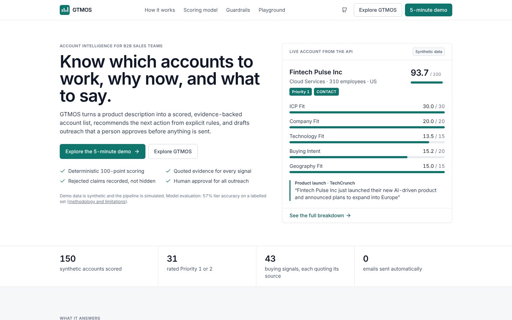

# GTMOS — AI GTM Command Center

**Live demo:** not deployed yet. GTMOS is built for Vercel ([deployment guide](docs/deployment.md)),
but no public URL exists. Run it locally with the steps below.

> GTMOS scores accounts with deterministic, explainable rules and quotes the evidence behind
> every buying signal. It recommends a next action and drafts outreach that a person must
> approve. **AI handles language; deterministic, tested code makes the business decisions.**

> **All data is synthetic.** The 150 companies, 72 contacts and their research notes are made
> up (contact emails use `.example`). The sales pipeline is **simulated**. GTMOS has no
> customers, no pilots and no revenue, and its conversion figures say nothing about real buyers.



## Start here

| If you want to… | Go to |
|---|---|
| See the product in five minutes | The guided demo at **`/demo`** (local: <http://localhost:5173/demo>) |
| Understand the scoring, evaluation and known weaknesses | The methodology page at **`/app/methodology`** |
| Read the product story and decisions | [Product case study](docs/PRODUCT_CASE_STUDY.md) |
| See the presentation outline | [Internship presentation](docs/INTERNSHIP_PRESENTATION.md) |
| Follow the demo talk track | [Executive demo script](docs/EXECUTIVE_DEMO_SCRIPT.md) |
| Read the GTM hypotheses | [GTM strategy](docs/GTM_STRATEGY.md) |
| Understand the system | [Technical architecture](docs/TECHNICAL_ARCHITECTURE.md) (summary: [architecture.md](docs/architecture.md)) |

---

## Three questions GTMOS answers

1. **Who should I contact right now?** Accounts are scored on fit and intent separately, then
   tiered, and each one gets a rule-based next action.
2. **Why do they matter?** Buying signals are extracted from research notes, checked against
   the note text, decayed by age, and shown with their source. Rejected claims are kept and
   shown with 0 points.
3. **What should I say?** Drafts are built only from verified evidence. A fact-check refuses
   numbers that aren't in that evidence, and a person approves every draft. GTMOS never sends
   email.

## Product flow

```
Product description
  → ICP engine (LLM proposes, Pydantic validates)
  → Research engine (LLM proposes signals; code checks the quote against the note;
                     negated / unsupported / ambiguous claims are stored as rejected, 0 pts)
  → Scoring engine (deterministic, 100 pts)
        Fit /80: ICP 30 · company 20 · technology 15 · geography 15
        Intent /20: weight × strength × confidence × recency decay, minus disqualifier penalties
        Tiers: Priority 1 ≥ 90 · Priority 2 ≥ 75 · Priority 3 ≥ 50 · Low < 50
  → Recommendation engine (fixed rule table: tier + intent → CONTACT / PRIORITIZE /
                           NURTURE / RESEARCH / DEPRIORITIZE, with a rule id)
  → Personalization (LLM draft + fact-check guardrail; failing drafts are not saved)
  → Human review queue (pending → approved / rejected; approving never sends)
  → CRM pipeline (Research → Contacted → Replied → Meeting → Opportunity → Won / Lost)
  → Analytics + AI analyst (11 fixed analytics functions, no generated SQL)
```

## Worked example: Acme Technologies (the rumour test)

Acme is a strong firmographic fit: B2B SaaS, 240 employees, US, runs Zendesk. Its note mentions
"hiring", but the sentence says the hiring was a rumour and the CEO confirmed a hiring freeze.
GTMOS records that claim as rejected, so intent stays at zero.

| Component | Score | Max | Rule applied |
|-----------|-------|-----|--------------|
| ICP fit | 30 | 30 | Industry exact match (20) + pain-point overlap (10) |
| Company fit | 20 | 20 | 240 employees inside the 50–500 range |
| Technology fit | 4.5 | 15 | Zendesk matches; Salesforce, Intercom and Jira absent |
| Buying intent | 0 | 20 | The hiring rumour is rejected, not counted |
| Geography fit | 15 | 15 | US exact match |
| **Total** | **69.5** | **100** | **Priority 3 → DEPRIORITIZE** |

Compare Fintech Pulse Inc (78.5 fit + 15.2 intent = 93.7, Priority 1 → CONTACT). Its synthetic
note reports a product launch and a planned expansion into Europe.

## Core principles

| Principle | How it's enforced |
|-----------|------------------|
| **AI interprets, code decides** | The LLM never scores, filters, computes or picks an action |
| **Structured LLM output** | Every LLM response is validated by a Pydantic schema before use |
| **One LLM module, mock first** | All calls go through `app/ai/llm.py`; mock mode runs everything with no API key |
| **Explainability** | Every score has a per-component breakdown; every action cites its rule id |
| **Evidence provenance** | Each signal carries its evidence text, source, date and confidence |
| **Human in the loop** | Drafts need approval; only approved drafts can be marked as sent by a person |

---

## Architecture

```
┌───────────────────────────────┐   ┌────────────────────────────────┐
│ React web app (web/)          │   │ Streamlit dashboard            │
│ Landing · /demo · /app/*      │   │ (internal, local only)         │
│ Vite + Tailwind + Recharts    │   │ app/dashboard/home.py          │
└──────────────┬────────────────┘   └───────────────┬────────────────┘
               │ /api/*                             │ HTTP
┌──────────────▼────────────────┐   ┌───────────────▼────────────────┐
│ Public demo API               │   │ Full local API                 │
│ api/index.py → app/api/public │   │ app/api/main.py (create_app)   │
│ guard: write allowlist, rate  │   │ every route, no guard          │
│ limits, read-only template DB,│   │                                │
│ per-browser sandboxes, LLM    │   │                                │
│ forced to mock                │   │                                │
└──────────────┬────────────────┘   └───────────────┬────────────────┘
               └─────────────┬──────────────────────┘
                             │ same routers (app/api/routes/)
┌────────────────────────────▼───────────────────────────────────────┐
│ Services (app/services/): ICP, research, signal, scoring,          │
│ recommendation, personalization, CRM, analytics, analyst,          │
│ explainability, executive analytics, methodology                   │
└────────────────────────────┬───────────────────────────────────────┘
          ┌──────────────────┴──────────────┐
┌─────────▼──────────────────┐   ┌──────────▼───────────────────────┐
│ SQLAlchemy 2 → SQLite      │   │ app/ai/llm.py (mock | live)      │
│ (Postgres-ready, generic   │   │ live: Google Gemini, opt-in only │
│ JSON columns)              │   │ never enabled in the public demo │
└────────────────────────────┘   └──────────────────────────────────┘
```

- **Web app (`web/`).** React 18, React Router, Vite, Tailwind and Recharts. Routes: `/`
  (landing), `/demo` (guided six-step tour), and `/app`, `/app/accounts`, `/app/accounts/:id`,
  `/app/compare`, `/app/review`, `/app/pipeline`, `/app/analytics`, `/app/playground`,
  `/app/methodology`.
- **Backend (`app/`).** FastAPI routers in `app/api/routes/` (`products`, `accounts`, `drafts`,
  `pipeline`, `analytics`, and `web` for the website's read models such as `/web/accounts/{id}/explain`,
  `/web/executive` and `/web/methodology`).
- **Public demo (`api/index.py`, `app/api/public.py`).** A separately built FastAPI instance
  mounted at `/api`. Only 8 non-GET routes are allowed. Visitors' edits go to temporary
  per-browser sandbox copies (about 2 hours, on one server instance), and the app tells
  visitors when their edits are no longer shown.
- **Deployment target.** `vercel.json` builds `web/dist` and runs `api/index.py` as a Python
  function. The demo database is rebuilt in `/tmp` from the CSVs on each cold start.

Full detail, diagrams and data flow: [docs/TECHNICAL_ARCHITECTURE.md](docs/TECHNICAL_ARCHITECTURE.md).

## Stack

| Layer | Technology |
|-------|-----------|
| Web app | React 18.3 + Vite 5.4 + Tailwind 3.4 + Recharts 2.13 (`web/`) |
| API | FastAPI + Uvicorn |
| Internal dashboard | Streamlit (local only) |
| ORM / database | SQLAlchemy 2 on SQLite (database-agnostic, Postgres-ready) |
| Validation | Pydantic v2 |
| Analytics | Pandas + SQL |
| LLM | Google Gemini in opt-in live mode; mock adapter by default |
| Testing | pytest, **357 tests** in 24 modules (mock mode, temporary database) |
| CI | GitHub Actions runs pytest on every push and on pull requests to `main` |
| Automation | n8n workflow exports in `n8n/workflows/` (not run as part of the app) |

## Module summaries

| Module | Purpose |
|--------|---------|
| `app/services/icp_engine.py` | LLM → Pydantic-validated ICP profile |
| `app/services/research_engine.py` | Research notes → checked signals, stored rejections and note provenance |
| `app/services/signal_engine.py` | Recency-decayed, newest-per-type intent score (0–20) |
| `app/services/scoring_engine.py` | 100-point deterministic scorer |
| `app/services/recommendation_engine.py` | Rule table → action, rule id, persona and angle (no LLM) |
| `app/services/personalization.py` | LLM draft + fact-check guardrail |
| `app/services/crm_service.py` | Stage transitions, activity log, mark-as-sent |
| `app/services/analytics_engine.py` | Funnel metrics, trends and breakdowns |
| `app/services/analyst_service.py` | Routes questions to one of 11 analytics functions |
| `app/services/explainability.py` | Per-account explanation: score components, signal arithmetic, rejected claims |
| `app/services/executive_analytics.py` | Five executive questions with observations vs labelled hypotheses |
| `app/services/methodology.py` | Live ICP, scoring rules and evaluation results for the methodology page |
| `app/api/public.py` | Public-demo guard and per-browser sandboxes |
| `app/ai/llm.py` | The single LLM entry point, mock and live |
| `app/ai/evaluators.py`, `app/ai/run_eval.py` | Evaluation suite and CLI runner |

---

## Evaluation results (mock mode)

> Computed by `python -m app.ai.run_eval --mode mock` on 100 labelled accounts and 60 labelled
> signal sentences, all synthetic and labelled by the project author. Details:
> [docs/evaluation.md](docs/evaluation.md) and the methodology page.

| Metric | Value | Caveat |
|--------|-------|--------|
| **Tier accuracy** | **57.0%** (57 / 100) | The headline number; not tuned away |
| **Priority 2 recall** | **0%** | All 19 true Priority 2 accounts are predicted Priority 1 |
| Priority 1 precision / recall | 36.7% / 100% | Over-promotes to Priority 1 |
| Low-fit recall | 100% | Disqualified accounts are filtered |
| Signal precision / recall / F1 | 100% / 100% / 100% | Uses a **simplified keyword matcher**, not the production extractor, on easy sentences |
| Draft fact-check | 30 / 30 grounded | Mock-generated drafts |
| Scoring determinism | 0 drift over 5 runs | 100 accounts |

**Why Priority 2 fails:** the labelled accounts have no research notes, so the tier evaluation
uses the scorer's built-in **proxy intent** (support-team size and funding stage). That pushes
good-fit accounts past 90. The product's real intent path (verified signals) isn't measured by
this evaluation.

---

## Run GTMOS locally (Windows PowerShell, no Docker)

Prerequisites: Python 3.11, and Node.js 18+ for the web app. Run every command from the project root.

```powershell
# 1. Create and activate a virtual environment
py -3.11 -m venv .venv
Set-ExecutionPolicy -Scope Process -ExecutionPolicy Bypass -Force
.\.venv\Scripts\Activate.ps1

# 2. Install dependencies (runtime + Streamlit + test tools)
pip install -r requirements-dev.txt
#    requirements.txt is the slim runtime set that Vercel installs

# 3. Build the demo database (ICP, 150 scored accounts, signals, simulated pipeline)
python scripts/demo.py
```

### Option A — the web app, as the public demo runs it

```powershell
# Terminal 1: public demo API (guarded, mock LLM)
uvicorn api.index:app --reload --port 8000
```

```powershell
# Terminal 2: the React app (proxies /api to port 8000)
cd web; npm install; npm run dev
```

Open <http://localhost:5173>, then **Explore the 5-minute demo**, or go straight to
<http://localhost:5173/demo> or <http://localhost:5173/app/methodology>.

### Option B — the full local API and Streamlit dashboard

```powershell
# Terminal 1: full API (every route, no public-demo guard)
uvicorn app.api.main:app --reload
```

```powershell
# Terminal 2: internal Streamlit dashboard
streamlit run app/dashboard/home.py
```

### Tests, evaluation and analyst

```powershell
python -m pytest
python -m pytest --cov=app/services
python -m app.ai.run_eval --mode mock
python scripts/ask_three_questions.py
```

Optional: `python -m app.db.init_db` creates empty tables. Live LLM mode is opt-in through
`LLM_MODE=live` and `LLM_API_KEY` in `.env` (see `.env.example`); it is never used by the
public demo or the tests.

---

## Status

**Implemented**
- [x] ICP engine, research engine with stored rejections, 100-point scoring, recommendation rule table
- [x] Personalization with a fact-check guardrail, human review queue, CRM pipeline, analytics, AI analyst
- [x] Evaluation suite, n8n workflow exports, demo script, CI
- [x] React web app: landing page, guided `/demo`, accounts and fit × intent map, account
      evidence inspector, comparison, review queue, pipeline, executive analytics, playground,
      methodology
- [x] Public-demo safeguards: write allowlist, rate limits, read-only template database,
      per-browser sandboxes, mock-only LLM, sandbox-loss notice
- [x] **357 tests passing** (mock mode, isolated temporary database); 96% line coverage of `app/services`

**Not done**
- [ ] Public deployment (no live URL yet)
- [ ] Any real users, pilots or customer interviews

## Roadmap (proposed, not built)

| Feature | Status |
|---------|--------|
| Discovery conversations and 2–3 supervised pilots | Next step |
| Recalibrate scoring on pilot outcomes (Priority 2, double penalty) | Proposed |
| Stricter whole-quote evidence check | Proposed |
| Live-model evaluation on real notes | Proposed (live mode exists, unevaluated) |
| Postgres | Config change via `DATABASE_URL`; not yet run |
| Authentication, workspaces, CSV import | Proposed |
| CRM sync | Proposed |
| Automated sending | **Not planned**: a person always sends |

## Why this project

Many GTM tools score accounts without explaining why, write AI drafts without review, and
report analytics without evidence. GTMOS tries the opposite:

- **Every score is explainable:** each rule shows the points it contributed.
- **Every signal has a source,** and rejected claims are logged rather than hidden.
- **No email is sent automatically:** people approve and people send.
- **Every metric is computed, not generated:** the analyst only cites numbers from the analytics engine.
- **The test suite is the contract:** 357 tests, runnable without an API key.

> All accounts, contacts, signals and pipeline activity are synthetic demo data. No real
> company data is scraped or used.
