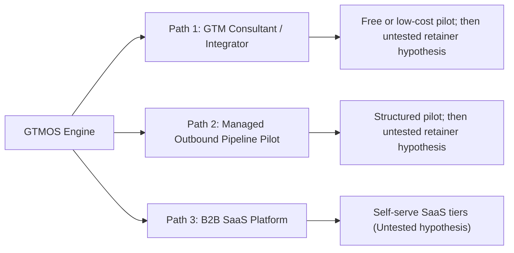

# GTMOS Commercialization Blueprint: From Codebase to Product & Startup

## 1. Executive Summary & Value Proposition

### What You Currently Have
**GTMOS** is a deterministic, AI-augmented Go-To-Market (GTM) qualification and personalization engine:
- **100-Point Deterministic ICP Scoring**: Explainable, rule-based qualification (scoring is deterministic code, and draft claims are checked against evidence, which reduces but does not eliminate unsupported claims).
- **Signal Extraction & Recency Decay**: Ingests organizational signals (hiring, funding, tech stack changes) with fuzzy evidence grounding.
- **Guardrailed Personalization**: Contextual email draft generation backed by factual verification to reduce unsupported claims.
- **Human-in-the-Loop CRM Pipeline**: Built-in 7-stage sales funnel with strict transition rules, safety controls (preventing automated cold-spam disasters), and an AI Analyst.
- **Automated Test Suite**: 177 unit/integration tests passing with 88% service layer coverage, running either mock or Google Gemini live.

### Current Evaluation Status and Known Limits
Evaluation metrics from the latest benchmark run in `docs/evaluation.md`:

- **Run Mode**: `mock` mode (synthetic accounts and signals; ground truth labels were authored by the project author, not an external third party).
- **ICP Tier Classification Accuracy**: **57.0%** (57 / 100 on synthetic labeled evaluation set).
  - Priority 1: Precision 36.7%, Recall 100.0%, F1 53.7%
  - Priority 2: Precision 0.0%, Recall 0.0%, F1 0.0% (scorer shifted boundary accounts into Priority 1)
  - Priority 3: Precision 100.0%, Recall 31.4%, F1 47.8%
  - Low Fit: Precision 61.4%, Recall 100.0%, F1 76.1%
- **Signal Extraction**: Precision **100.0%**, Recall **100.0%**, F1 **100.0%** on 60 author-labeled synthetic evaluation signals (42 supported, 18 unsupported).
- **Outreach Draft Fact-Checking**: 30 drafts evaluated, 30 verified grounded (0.0% unsupported claim rate on mock-generated evaluation drafts).
- **Scoring Consistency**: Fully deterministic (**0 drift** across 5 repeated runs of 100 accounts).
- **Known Limits**:
  - Evaluation was run in `mock` mode against synthetic CSV datasets rather than live production CRM data.
  - The scoring weights were calibrated against author-defined criteria and must be tuned against real-world customer conversion history.
  - Signal keyword matching checks for keyword presence in raw text; nuanced or adversarial text requires ongoing validation.

### The Commercial Problem It Solves
Most B2B outbound fails for two reasons:
1. **Generic spray-and-pray outbound**: Sales teams email thousands of leads scraped from Apollo or ZoomInfo with generic copy, leading to burnt domains and low reply rates.
2. **"AI Outbound" Hallucinations**: Tools using pure unconstrained LLMs generate unverified claims, fictional product synergy, or score leads unpredictably.

**Your Differentiator**: 
> *"Deterministic Qualification + Fact-Grounded Personalization + Human Review."* 
> You give sales leaders total visibility into **why** an account was chosen (transparent score breakdown), backed by factual signal extraction and compliant human-in-the-loop workflows.

---

## 2. Validation Gate (Before Any Commercial Build)

Before writing production multi-tenant code, frontend rewrites, or commercial infrastructure, the product thesis must pass a strict customer validation gate. **Success thresholds are fixed before interviews start.**

### 10 Customer Discovery Conversations
Conduct structured 30-minute interviews with 10 target buyers (Heads of Sales, VP Demand Gen, or Founders at Seed–Series A B2B companies with active outbound sales).

**Questions to Validate:**
1. *How do you currently qualify and score accounts before sales reps reach out?*
2. *How much time do reps spend researching an account and drafting custom messaging?*
3. *What is your biggest fear or friction point with existing AI outbound tools (e.g., hallucinations, domain reputation, compliance)?*
4. *Walk me through the last account you or your rep researched before outreach: how long did it take, what sources did you check, and what happened next?*

### How to Find 10 Interviewees
- **Warm Founder Network**: Reach out to founders in your existing professional network, alumni groups, or local tech communities.
- **Sales Leader Communities**: Engage in B2B sales communities (e.g., RevGenius, Pavilion, Modern Sales Pros) asking for 20-minute feedback discussions on outbound workflows (no selling).
- **Targeted LinkedIn Outreach**: Connect with Seed–Series A founders or Heads of Sales with a clear learning ask: *"Researching how B2B teams handle account qualification vs. rep research time; would love 15 minutes of your perspective in exchange for sharing aggregated industry findings."*
- **SDR / Outbound Practitioners**: Interview active SDRs and BDRs on Twitter/X or LinkedIn to understand daily friction points in account research.

### Defined Success Criteria (Go / No-Go Gate)
- **Minimum 6 of 10** interviewees identify account qualification/research quality or AI hallucination risk as a top-3 outbound problem.
- **Minimum 2 companies** agree to participate in a free or low-cost pilot using their real ICP criteria in exchange for feedback and an attributed case study/testimonial.
- **If criteria are not met**: Iterate on the positioning, ICP criteria, or workflow before investing development time into commercial infrastructure.

---

## 3. Competitive Positioning

| Competitor Category | Key Players | How They Work | Where GTMOS Wins (The Gap) |
| :--- | :--- | :--- | :--- |
| **Data & Spreadsheet Enrichment** | **Clay** | Powerful spreadsheet-based waterfall enrichment and API scraping. Highly customizable. | Clay requires complex setup and formula maintenance *(pricing models vary, check vendor pricing page)*. GTMOS provides an opinionated, out-of-the-box deterministic qualification engine with built-in human review and pipeline tracking. |
| **B2B Databases & Sequences** | **Apollo.io, ZoomInfo** | Massive contact databases with built-in email sequence deliverability. | Great for contact discovery, but lead scoring is rudimentary and personalization is generic templating *(contract sizes and terms vary, check vendor pricing page)*. GTMOS sits on top as an intelligent qualification and grounded draft generation layer. |
| **Intent & Signal Aggregators** | **Common Room, 6sense** | Aggregates community, product, and website intent signals for enterprise sales teams. | Enterprise-oriented with extensive implementation cycles *(contract sizes vary, unverified, check vendor pricing page)*. GTMOS focuses on accessible, transparent signal scoring with direct draft grounding for agile teams. |
| **"AI SDR" Tools** | **Artisan (Ava), 11x (Alice)** | Promise end-to-end hands-off outbound: auto-prospecting, auto-writing, and auto-sending *(quality and delivery performance unverified, check vendor specifications)*. | Hands-off unmonitored outreach carries inherent risk of unverified claims or off-brand copy. GTMOS emphasizes **human-in-the-loop oversight**, fact verification, and explainable scoring rather than unmonitored sending. |

---

## 4. Legal & Compliance Framework

> **Important Notice**: This section is for informational and architectural guidance only and does **not** constitute legal advice. Consult a qualified attorney to review your data handling, outreach practices, and client agreements.

### Acting as a Data Processor: NDA and DPA First
When operating GTMOS for client accounts, you handle proprietary sales data, prospect contacts, and internal ICP rules.
- **Non-Disclosure Agreement (NDA)**: Must be executed prior to reviewing client sales playbooks, customer lists, or proprietary signals.
- **Data Processing Agreement (DPA)**: A formal DPA must be signed before ingesting any client contact or CRM data. The DPA establishes:
  - That the client remains the Data Controller and GTMOS operates strictly as a Data Processor.
  - The explicit purpose, scope, and duration of processing.
  - Security safeguards, breach notification windows, and data deletion or return obligations upon termination.

### CAN-SPAM Act (United States)
- Commercial emails must include clear, conspicuous disclosure that the message is an advertisement (if applicable).
- Valid physical postal address of the sender must be included in every message footer.
- Clear, functioning opt-out/unsubscribe mechanism that must be honored within 10 business days.
- Deceptive headers, "From" lines, or misleading subject lines are strictly prohibited.

### GDPR, UK PECR & European Variations
- **GDPR (EU / UK)**:
  - **Legitimate Interest**: Outbound B2B communication to EU/UK corporate contacts requires documented Legitimate Interest Assessments (LIA) showing relevance to the recipient's professional role.
  - **Data Minimization & Storage Limitation**: Store only professional contact details necessary for B2B engagement; delete data when retention is no longer justified.
  - **Right to Object / Erasure**: Immediate, frictionless process to honor "Do Not Contact" requests across all tenant databases.
- **UK PECR & Member State Variations**: Note that the Privacy and Electronic Communications Regulations (PECR) in the UK and national transpositions of the ePrivacy Directive vary significantly across EU member states:
  - In some countries (e.g., UK B2B corporate subscribers), opt-out cold emailing to corporate email addresses is permitted under specific conditions.
  - In other member states (e.g., Germany), opt-in consent requirements for unsolicited commercial email are strictly enforced, even for B2B communications. Local legal counsel is required before contacting specific European jurisdictions.

### India Digital Personal Data Protection (DPDP) Act
- Clear notice and legitimate use provisions for processing digital personal data.
- Personal data must be protected with reasonable security safeguards to prevent breaches.
- Obligations to erase data upon withdrawal of consent or cessation of purpose.

### Billing Foreign Clients from India (Business, GST & Payments)
If operating or billing clients from India:
- **Entity Setup**: Sole proprietorship, LLP, or Private Limited company registration.
- **GST & Export of Services**: Export of software or consulting services is treated as a "Zero-Rated Supply" under GST. File a Letter of Undertaking (LUT) to export services without paying IGST upfront.
- **Inward Remittances**: Use compliant cross-border payment processors (e.g., Stripe, Wise Business, PayPal, or international wire via bank). Ensure your bank provides a Foreign Inward Remittance Certificate / Advice (FIRC/FIRA) for each transaction for tax and RBI compliance.

### Data Provider Terms of Service
- Scraping or enriching data via third-party providers (e.g., Apollo, LinkedIn, Crunchbase) must comply with their respective API developer agreements and terms of service.
- Avoid unauthorized platform scraping that violates platform terms or anti-scraping laws.

---

## 5. Three Monetization Paths

Depending on capital, network, and timeline, here are three ways to monetize:

---

### Path 1: GTM Consultant / Integrator
- **How it works**: Implement GTMOS as a tailored qualification and personalization engine for B2B startups ($1M–$10M ARR).
- **Offer**: *"I will audit your ICP, configure your custom scoring engine, wire buying intent signals into your workflow, and generate fact-grounded personalized drafts that your reps can review and approve in one click."*
- **Pricing**:
  - **First Pilot**: Free or low-cost pilot in exchange for qualitative feedback and an attributed testimonial upon milestone completion.
  - *Untested pricing hypothesis for later clients*: $3,500 – $7,500 setup fee; $1,000 – $2,000/month ongoing maintenance.

---

### Path 2: Managed Outbound Pipeline Pilot (Operator Model)
- **How it works**: Run GTMOS on behalf of the client, identifying target accounts, applying signal-based qualification, and preparing grounded messaging for their sales reps to review and execute.
- **Pilot Structure (No Outcome Promise)**:
  - 4-week structured pilot.
  - Deliverable: Audit client ICP, score 200 target accounts, extract verified signals, and deliver approved, fact-checked drafts for sales rep review.
  - Makes no guaranteed meeting or outcome promises; success is evaluated on lead quality, research accuracy, and rep review efficiency.
  - *Untested pricing hypothesis for later clients*: $3,000 – $5,000/month retainer.

---

### Path 3: Full B2B SaaS Product (Micro-SaaS)
- **How it works**: Package GTMOS into a self-service web application where sales leaders upload account lists, configure ICP rules via UI, and manage draft reviews.
- **Untested Pricing Hypotheses**:
  - **Starter** ($149/mo): 500 accounts scored/mo, 1 product ICP, CSV export.
  - **Growth** ($399/mo): 2,500 accounts/mo, CRM bi-directional sync (HubSpot/Salesforce), draft review queue.
  - **Scale / Enterprise** ($899+/mo): 10,000 accounts/mo, licensed data source integrations, multi-seat workspace.

---

## 6. Technical & Product Production Gaps (What's Missing)

To transition from an engineering prototype to a commercial system, the following technical gaps must be resolved:

### 1. Multi-Tenancy & Data Isolation (Critical for SaaS)
- **Current State**: Single SQLite database (`gtmos.db`). All products, accounts, and scores share one table space.
- **Required**:
  - Migrate to **PostgreSQL**.
  - Add an `organization_id` or `tenant_id` to every table (`Account`, `Product`, `Score`, `Draft`, `Activity`).
  - Row-Level Security (RLS) or tenant-aware SQLAlchemy query filters to guarantee strict data segregation.

### 2. User Authentication & Role-Based Access Control (RBAC)
- **Current State**: Open FastAPI endpoints with no authentication.
- **Required**:
  - Implement JWT authentication (e.g., Supabase Auth, Clerk, or FastAPI-Users).
  - User roles:
    - `Admin`: Configures ICP, scoring weights, API keys, and CRM connections.
    - `SDR / Rep`: Views account queue, edits/approves drafts, updates stages.
    - `Executive`: View-only access to Analytics & AI Funnel Analyst.

### 3. Native CRM Integrations
Sales reps require integration with their daily workflows:
- **HubSpot & Salesforce APIs**:
  - Ingest contacts/companies via webhook triggers.
  - Push approved outreach drafts into CRM tasks or sequence queues.
  - Two-way stage sync: reflect pipeline stage changes in both systems.
- **Email Sending Tools (Instantly / Smartlead / Outreach)**:
  - Once a draft is approved in GTMOS, enqueue it into an outreach sequence via API.

### 4. Automated Signal Ingestion (Replacing CSVs)
Currently, signals and accounts come from static CSV files:
- **Enrichment APIs**:
  - **Apollo / People Data Labs / Crustdata**: Company size, revenue, tech stack, job titles.
  - **Job Boards / Public Career Feeds**: Hiring signals with source attribution.
  - **Funding feeds**: PredictLeads or Crunchbase webhooks.

### 5. Domain Warmup & Deliverability Safety
- Configure dedicated secondary domains for outbound communication.
- Ensure proper technical setup: SPF, DKIM, DMARC, and custom tracking domains.
- Adhere to mailbox provider sending thresholds to maintain domain health.

---

## 7. UI/UX Upgrades: Moving Beyond Streamlit

While Streamlit is effective for local prototypes, commercial products require a responsive, low-latency UI:

| Component | Current (Streamlit) | Recommended Production Stack |
| :--- | :--- | :--- |
| **Frontend** | Streamlit Python pages | **Next.js 14 / React + Tailwind CSS + shadcn/ui** |
| **Backend API** | FastAPI (Already Built!) | Keep FastAPI — production-grade, fast, typed |
| **Database** | SQLite file | **PostgreSQL (Supabase or Neon)** |
| **Task Queue** | Synchronous loops / scripts | **Celery or Temporal + Redis** for batch scraping and scoring |
| **Auth** | None | **Clerk** or **Auth0** |
| **Billing** | None | **Stripe Billing / Checkout** |

---

## 8. 90-Day Execution Plan

### Month 1: Validation & Pilot Execution (Days 1–30)
1. **Validation Gate**: Complete 10 customer discovery interviews; secure 2 pilot partners.
2. **Pilot Delivery**: Run GTMOS for pilot clients using their real ICP criteria.
3. **Pilot Deliverables**:
   - Ingest target accounts.
   - Run scoring engine and generate personalized, fact-checked drafts for sales rep review.
   - Deliver drafts directly into their existing workflow.
4. **Outcome**: Collect structured user feedback and measure real performance metrics:
   - *Metric to be measured from a real pilot* (e.g., reply rate impact vs. baseline, SDR time saved per qualified account).
5. **Day 30 Decision Gate**: **Months 2 and 3 only start if the validation criteria are met** (minimum 6/10 customer interviews identify this as a top-3 problem, and minimum 2 pilot commitments secured with positive qualitative feedback). If criteria are not met, halt engineering spend and iterate on positioning.

### Month 2: Productization & Core Integrations (Days 31–60)
*(Conditioned on passing Day 30 Decision Gate)*
*Goal: Turn pilot learnings into core software features.*
1. Migrate database from SQLite to hosted PostgreSQL.
2. Build HubSpot / Instantly.ai webhooks to automate lead delivery.
3. Add Clerk authentication and organization/tenant partitioning.
4. Replace manual CSV loading with a one-click CSV uploader and enrichment API connector.

### Month 3: Self-Serve Beta (Days 61–90)
*(Conditioned on passing Day 30 Decision Gate)*
*Goal: Launch self-serve beta.*
1. Deploy Next.js frontend with self-serve billing tiers.
2. Publish interactive demo environment so prospects can test scoring a sample domain.
3. Offer a 14-day trial (limited to 50 scored accounts).
4. Publish case study based on real pilot findings with verified metrics and attributed testimonials.
