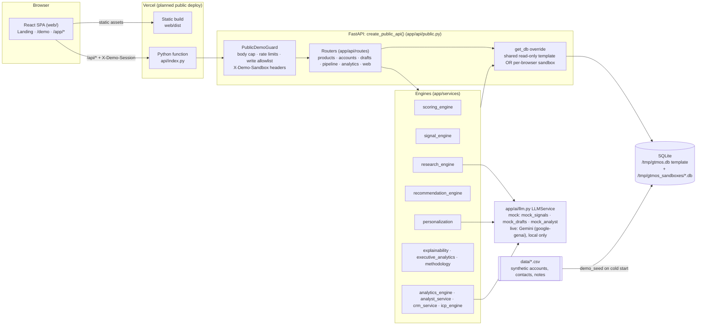
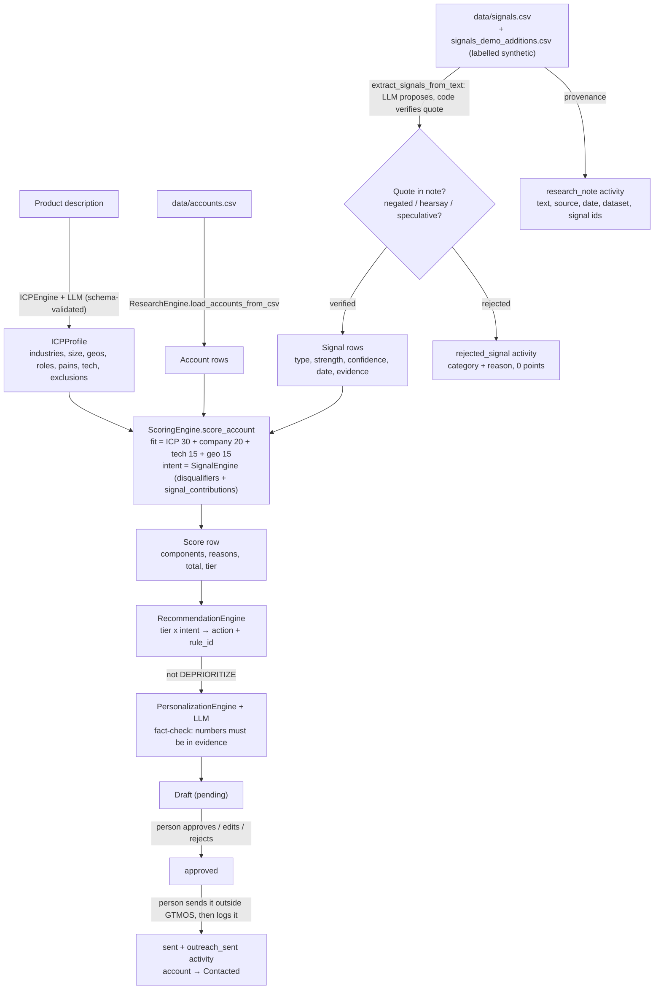
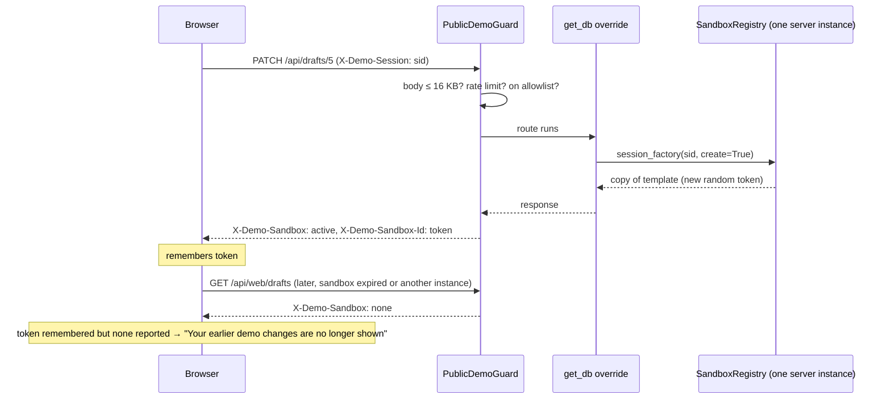

# GTMOS — Technical Architecture

> **Core principle: AI handles language. Deterministic, tested code controls business decisions.**
> A language model may read research notes, propose an ICP, write a draft, and pick which
> predefined analytics query to run. It never scores an account, filters a list, does
> arithmetic or chooses an action. Every model output is validated against a Pydantic schema
> before any engine uses it.

Verified against the repository at the T6 commit. File paths are relative to the repo root.

---

## 1. System overview

**Locally**, the same code runs without Vercel:
- `uvicorn api.index:app --port 8000`: the guarded public API
- `uvicorn app.api.main:app`: the full, unguarded API
- `npm run dev` in `web/` (proxies `/api` to port 8000)
- the original Streamlit dashboard: `streamlit run app/dashboard/home.py` (reads SQLite
  directly via `SessionLocal`; pings the API's `/health`)

**Deployment status:** `vercel.json` and `api/index.py` are ready, but **nothing has been
deployed** (GitHub access for the push was not available). Vercel's handling of the Python
function is unverified until the first build log.

## 2. Data flow: from product description to an approved draft

The demo database is built by `app/db/demo_seed.py`:
1. product and ICP (mock)
2. 150 accounts
3. baseline notes, then the 3 labelled additions, sharing one exact date shift so the newest note is "now"
4. scores
5. a seeded 40-day pipeline simulation (`scripts/seed_activity.py`)
6. 72 fictional contacts
7. 6 pending drafts

## 3. Frontend (`web/`)

- React 18, Vite 5, Tailwind 3, Recharts (weekly chart only; lazy-loaded), lucide icons.
  No state library; a small `useAsync` hook, plus `DemoContext` for the guided tour.
- **Routes:** `/`, `/demo`, `/app` (Overview), `/app/accounts`, `/app/accounts/:id`,
  `/app/compare`, `/app/review`, `/app/pipeline`, `/app/analytics`, `/app/playground`,
  `/app/methodology`.
- **The frontend never computes scores.** It displays API values. The only rule text it holds
  is plain-English restatements keyed by `rule_id`, always shown next to the API's verbatim rule.
- **`web/src/lib/api.ts`:** a typed client that sends `X-Demo-Session` (a random per-browser
  id), and passes every response to `observeSandbox` (§9).
- **Design system:** light theme, one teal accent, WCAG AA text contrast, validated chart
  palettes. axe-core reports 0 WCAG 2 A/AA violations on all checked views.

## 4. API architecture

`app/api/main.py: create_app()` builds the **full API** (all routers plus `/health`, with a
generic 500 handler). `app/api/public.py: create_public_api()` builds a **separate instance**
for the public demo. It overrides `get_db` and adds `PublicDemoGuard`. `api/index.py` seeds
the database, forces `LLM_MODE=mock`, and mounts the public API at `/api`.

| Group | Endpoints |
|---|---|
| Health | `GET /health` |
| Products / ICP | `GET, POST /products` · `GET /products/{id}` · `POST /products/{id}/generate-icp` · `POST /products/{id}/score-all` |
| Accounts | `GET /accounts` · `GET /accounts/{id}` · `POST /accounts/{id}/score` · `POST /accounts/{id}/research` · `GET /accounts/{id}/signals` · `POST /accounts/{id}/personalize` · `POST /accounts/{id}/stage` · `POST /accounts/{id}/contacts` · `GET /accounts/{id}/activities` · `POST /accounts/{id}/mark_sent` |
| Drafts | `GET /drafts` · `GET, PATCH /drafts/{id}` · `POST /drafts/{id}/approve` · `POST /drafts/{id}/reject` |
| Pipeline / analytics | `GET /pipeline` · `GET /analytics/funnel` · `GET /analytics/trends` · `POST /analytics/ask` |
| Web app | `GET /web/overview` · `GET /web/accounts` · `GET /web/accounts/{account_id}` · `GET /web/accounts/{account_id}/explain` · `GET /web/compare?ids=` · `GET /web/comparisons/featured` · `GET /web/prioritization` · `GET /web/drafts` · `GET /web/executive` · `GET /web/executive/{question_id}` · `GET /web/methodology` · `POST /web/playground` · `POST /web/reset` |

**Public write allowlist** (`WRITE_POLICY`): `POST /web/playground`, `POST /analytics/ask`,
`POST /web/reset`, `POST /accounts/{id}/personalize`, `POST /accounts/{id}/mark_sent`,
`PATCH /drafts/{id}`, `POST /drafts/{id}/approve`, `POST /drafts/{id}/reject`. Every other
non-GET request returns **403** before reaching a route.

## 5. Database

- SQLAlchemy 2 models (`app/models/models.py`): Product, ICPProfile, Account, Signal, Score,
  Contact, Activity, Opportunity, Draft. Generic `JSON` columns keep it database-agnostic,
  so moving to Postgres only needs `DATABASE_URL`.
- **Local:** `sqlite:///./gtmos.db`.
- **Public demo:** the template is `sqlite:////tmp/gtmos.db`, rebuilt on each cold start
  (about 3–4.5 s). The function filesystem is read-only except `/tmp`.
- **Provenance lives in `Activity` rows** (`research_note`, `rejected_signal`), so no schema
  migration was needed.

## 6. Scoring engine (`app/services/scoring_engine.py`)

- `compute_score(AccountData, ICPData)` is a **pure function**. `score_account` loads the
  ICP, gets intent from the signal engine, and persists a `Score` with components and reasons.
- Components: ICP 30, company 20, technology 15, geography 15, intent 20. `TIER_THRESHOLDS`
  is 90 / 75 / 50. `REASON_COMPONENT` maps each reason to its component for explanations.
- If no intent override is passed, `compute_score` uses a **proxy intent** (support-team size
  and funding stage). The app always passes signal-based intent; **the evaluation does not**
  (§11).

## 7. Signal extraction and intent

- **Extraction** (`research_engine.extract_signals_from_text`): the LLM returns
  `SignalListSchema` (signals and rejected claims). Code rejects any signal whose quote is
  absent from the note. Verified signals become `Signal` rows; rejections become
  `rejected_signal` activities with `points: 0`. Re-ingesting an identical note records
  nothing new.
- **Offline stand-in** (`app/ai/mock_signals.py`): splits sentences, skips negated or hearsay
  ones (and records why), quotes the matching sentence, and flags hedged sentences as
  ambiguous.
- **Intent** (`signal_engine.py`): `signal_contributions()` is the single implementation of
  `weight × strength × confidence × decay`, newest signal per type. `score_signals()` sums
  and clamps it to 0–20. Disqualifiers (`derive_negative_signals`) are negative-weight
  signals. Weights live in `signal_config.SIGNAL_WEIGHTS`; decay is 1.0 up to 90 days, 0.5
  up to 180, then 0.

## 8. Explainability, executive analytics and methodology

- **`explainability.explain_account`:**
  - fit components and reasons straight from the stored `Score`
  - per-signal contributions recomputed with `signal_contributions()` at the scoring time
  - a `matches_stored_score` self-check
  - the action rule id from `RecommendationEngine`
  - rejected evidence and note provenance
- **`executive_analytics`:**
  - one snapshot of the database through the same engines
  - five deterministic questions, each returning observations, labelled hypotheses,
    selection rules, data sources, provenance and data-quality notes
  - `prioritization_rows()` for the accounts table
- **`methodology`:** constants read from the code (weights, decay, tiers, action rules), plus
  the evaluation computed live with `GTMOSEvaluator` (about 10 ms).
- **`analyst_service`:**
  - The model returns only a function name from an 11-entry allowlist; anything else
    becomes `unknown`, and parameters are ignored.
  - Executive answers are assembled by code.
  - Legacy answers get data-derived `observations` regardless of model wording.

## 9. Public demo sandbox and loss detection

- **Reads** use the shared template opened read-only (`mode=ro`), or the caller's sandbox
  if one exists.
- **Allowed writes** use or create the caller's sandbox, a private SQLite copy.
- Sandboxes expire after 2 hours (TTL) and are capped at 200 per instance, least recently
  used evicted first.
- Rate limits: 120 requests a minute, 30 writes a minute and 5 resets a minute, per IP,
  **per instance**.
- Reset deletes only the caller's sandbox.
- **Loss detection:** each sandbox has a random token. A remembered token followed by
  "none" or a different token means the edits are gone (expired, evicted, another instance,
  or recreated). The browser shows a persistent notice. An intentional reset never triggers it.
- **The session ID is not authentication,** and this design must never hold real customer data.

## 10. Offline AI adapter (`app/ai/llm.py`)

- `LLMService.generate_structured(prompt, schema)` is the only path to a model.
  - `mock` mode returns deterministic, schema-valid data: ICP, signals and rejections,
    evidence-quoting drafts, analyst routing and data-only explanations.
  - `live` mode calls Gemini through `google-genai`, validates the output, and retries once.
  - Live mode with no key fails loudly.
- **The public API forces `mock`** whatever the environment says (tested with
  `LLM_MODE=live` and a key set). The default model name (`gemini-3.8-flash`) is unverified.

## 11. Testing and evaluation

- **357 backend tests** (pytest, 24 test modules), run in mock mode against a temporary SQLite file
  (`tests/conftest.py`). They include:
  - **35 security regression tests** and **32 adversarial review tests** (alternate paths,
    sandbox isolation, error leakage, offline enforcement)
  - **10 sandbox-status tests**
  - a **golden-file test** pinning all 150 baseline accounts' scores, tiers, actions and stages
  - explainability tests checking every account's recomputed intent against its stored score
- **Evaluation** (`app/ai/evaluators.py`, `python -m app.ai.run_eval --mode mock`):
  - tier accuracy 57% on 100 labelled synthetic accounts, using **proxy intent**
  - signal metrics on 60 sentences with a **simplified keyword matcher**
  - determinism over 5 runs
  - draft fact-check on 30 drafts
- **Browser checks** (Playwright; scripts not committed): every page at 1440 px and 390 px,
  the guided demo, sandbox loss scenarios, and axe-core accessibility.
- **Deployment smoke test** (committed): `python scripts/smoke_test.py <url> --frontend`
  makes 15 checks.
- **CI:** `.github/workflows/pytest.yml` runs pytest and the evaluation on every push
  (Python 3.11).

## 12. Runtime and dependencies

- `requirements.txt` holds pinned runtime dependencies (about 159 MB installed on 3.12).
  `requirements-dev.txt` adds Streamlit, pytest and httpx.
- Tested on Python 3.11, 3.12 and 3.13. `.python-version` is 3.12; CI and the Dockerfile
  use 3.11.
- n8n workflow JSON files are exported in `n8n/workflows/` but have not been run.
